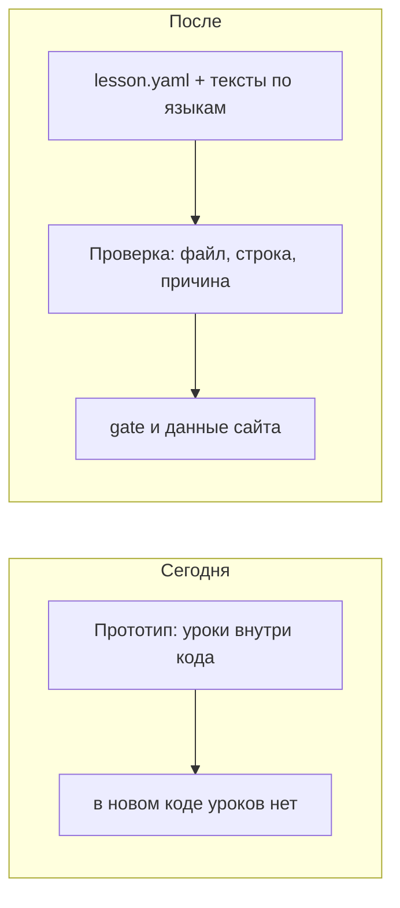

# Design: M1.1 — Формат урока в YAML: схема данных и валидатор

> Status: awaiting-approval · Revision: r1 · Date: 2026-11-18 · Author: Claude (craftspec design)
> Artifact: https://claude.ai/artifact/Pert7Z6UKR1yd73v9vQukp
> Approvers: anyone · Quorum: 1
> Involvement: light
> Rounds: none
> Bench: none
> Tokens: none
> Accepted below AA: none
> Human touches: 1 · As built: not yet
> Playbook: `<CraftSpec>/playbooks/design.md`. Section order is fixed; write "none" if empty.

## 1. What changes for users

Урок становится двумя текстовыми файлами в репозитории: в одном описано, кто участвует и что
за чем происходит, в другом лежат тексты на одном языке. Чтобы добавить или поправить урок,
человек правит эти файлы и открывает pull request; если в файле ошибка, проверка называет файл,
строку и причину простыми словами. На сайте пока ничего не меняется: это основа, на которую
дальше встанут сцена, плеер и панель объяснения.

**How (for engineers):** `content/lessons/<id>/lesson.yaml` + `content/locales/<язык>/<id>.yaml`,
разбор пакетом `yaml`, свой валидатор в `src/core/lesson` с ошибками «файл:строка», проверка в
`npm run gate`, урок B1 как первый настоящий файл.

## 2. What changes

Интерфейс не меняется. Страница показывает пример файла урока B1 (структура и тексты) и схему
«до → после»: сегодня урока в новом коде нет; после — файлы урока проходят проверку и попадают
в данные сайта, а неверный файл останавливает gate.

Пример на странице: вкладка «Урок» (D1 — участники и зоны, D2 — шаги с пометкой защиты),
вкладка «Тексты» (D3 — что можно в тексте, D4 — три уровня объяснения).

## 3. Questions

### D1. Как автор урока расставляет участников на схеме?  ·  sketch: lesson

- **a. (Recommended)** Участники перечислены по порядку и встают в одну линию слева направо; зоны
  доверия задаются списком участников — так устроен прототип, который ты одобрил, и автору не
  нужны координаты.
  - Pros: проще всего написать и проверить; схемы всех уроков выглядят одинаково
  - Cons: больше шести участников в линию не помещается; ветвящиеся схемы придётся упрощать
- **b.** Клетки сетки: у участника столбец и ряд, рядов до двух — подходит для ветвлений, но
  автор должен думать о раскладке, а сцена становится сложнее.
  - Pros: можно показать два пути (например, настоящий сайт и подделку друг под другом)
  - Cons: больше способов сделать некрасиво; сцена и её проверка дороже примерно на треть
- **c.** Свободные координаты — полная свобода, но у каждого урока свой вид и легко получить
  наложения.
- **Something else** — comment required.

### D2. Как в файле описан ход «с защитой»?  ·  sketch: lesson

- **a. (Recommended)** Один список шагов; у шага пометка «всегда», «только без защиты» или «только
  с защитой» — общие шаги пишутся один раз.
  - Pros: нет повторов; сразу видно, чем защита меняет ход
  - Cons: номера шагов в двух режимах могут расходиться, это надо держать в голове автору
- **b.** Два полных списка шагов, как в прототипе — нагляднее читается каждый режим отдельно, но
  общие шаги дублируются и расходятся при правках.
  - Pros: каждый режим читается сверху вниз без условий
  - Cons: любую правку общего шага надо делать дважды; переводчик переводит одно и то же дважды
- **Something else** — comment required.

### D3. Что автор может делать в тексте урока?  ·  sketch: texts

- **a. (Recommended)** Только обычный текст и одна пометка — выделение вредной части в примере
  запроса; слова из словаря сайт находит сам, как в прототипе.
  - Pros: текст нельзя сломать и в него нельзя подложить разметку; переводчику нечего портить
  - Cons: нет жирного, списков и ссылок внутри объяснения
- **b.** Упрощённый Markdown: жирный, списки, ссылки — привычно авторам, но ссылки в тексте
  уводят с сайта, а разметку легко сломать при переводе.
  - Pros: выразительнее
  - Cons: нужна проверка каждой ссылки; больше ошибок в переводах
- **Something else** — comment required.

### D4. Обязательны ли все три уровня объяснения у каждого шага?  ·  sketch: texts

- **a. (Recommended)** Да: «Просто», «По шагам» и «Глубже» заполнены у каждого шага, иначе урок
  не принимается — так во всех трёх уроках прототипа и в сценарии S3.
  - Pros: переключатель глубины никогда не показывает пустоту; уроки ровные по качеству
  - Cons: урок дольше писать; новичку-автору выше порог
- **b.** Обязательно только «Просто», остальные по желанию — легче начать, но на части шагов
  переключатель будет неактивен.
  - Pros: проще прислать первый урок
  - Cons: неровный опыт; «Глубже» будут пропускать именно там, где оно нужнее всего
- **Something else** — comment required.

## 4. Engineering decisions

- **E1.** Два файла на урок: `content/lessons/<id>/lesson.yaml` (структура, без текста) и
  `content/locales/<язык>/<id>.yaml` (тексты по ключам шагов и участников) — K10; один файл с
  текстами внутри проиграл: перевод менял бы файл структуры.
- **E2.** Разбор YAML пакетом `yaml` (лицензия ISC, только при сборке и в тестах): он отдаёт
  строку и столбец каждого значения; `js-yaml` проиграл из-за отсутствия позиций узлов.
- **E3.** Валидатор свой, в `src/core/lesson`, без библиотек схем: ошибки — данные
  `{file, line, column, path, code, message}`, без исключений, как в реестре команд (K13); zod и
  ajv проиграли: новая зависимость ради десятка правил и чужие тексты ошибок.
- **E4.** Неизвестные ключи, якоря и теги YAML, дубли ключей, файлы больше 64 КБ — ошибка: файлы
  уроков приходят из pull request и считаются враждебными (L0.2).
- **E5.** Паспорт урока — поля, а не пары строк: `cwe`, `owasp`, `attack` (техники ATT&CK),
  `cvss` (вектор, необязательно), `cves`, `sources[]` с названием и адресом. Нужны будущему
  калькулятору CVSS и сверке фактов (L5).
- **E6.** Правила содержания в валидаторе (S8, L4): у урока об атаке есть хотя бы один шаг «только
  с защитой» и текст «Как защититься»; есть хотя бы один источник; все IP-адреса и домены во
  всех строках урока и текстов — только из учебных диапазонов; у каждого ключа структуры есть
  текст в языке `ru`.
- **E7.** Адреса в `sources[].url` — единственное место, где контенту разрешена внешняя ссылка;
  домен ссылки должен быть в списке `content/sources.yaml` (OWASP, MITRE, NVD, RFC Editor, FIRST,
  CISA, W3C, WHATWG, MDN), список расширяется через pull request. Сайт по ссылкам ничего не
  запрашивает (L6).
- **E8.** Виды сообщения: `legit`, `attack`, `safe`, как в прототипе; исход шага `stopped`
  отмечается отдельным полем, а не четвёртым видом.
- **E9.** В файле есть `format: 1` и зарезервированный ключ `sandbox`, который в первой версии
  обязан отсутствовать (место под песочницу, G2).
- **E10.** Проверка контента идёт тестом Vitest, который читает все файлы в `content/` и печатает
  ошибки списком «файл:строка: причина»; отдельная команда `npm run content` делает то же без
  остальных тестов. Сборка данных для сайта — плагин Vite, урок уходит отдельным файлом (бюджет
  30 КБ на урок).
- **E11.** Тексты ошибок валидатора — на английском, как остальные сообщения для разработчиков;
  руководство автора на русском и английском появится в M4.1.
- **E12.** Словарь в этот дизайн не входит: формат `glossary.yaml` и поиск слов проектируются в
  M2 вместе с панелью словаря; регулярные выражения из прототипа в файлы не переносятся.

## 5. How it is tested

**Summary:** уровень D (сценарий S8 и точные утверждения): урок B1 проходит, каждый испорченный
вариант файла падает с названным файлом, строкой и причиной.

| Check | Given / When / Then (or command) | Level |
|---|---|---|
| B1 проходит | Given файлы урока B1; When `npm run gate`; Then ошибок контента нет | D |
| S8: нет защиты | Given урок без шага «только с защитой»; Then gate красный, названы урок, поле, строка | D |
| S8: адрес вне учебных | Given `8.8.8.8` или `google.com` в любом тексте; Then ошибка с файлом и строкой | D |
| S8: нет источников | Given пустой `sources`; Then ошибка | D |
| Нет текста | Given шаг без уровня «Глубже» в `ru`; Then ошибка называет ключ | D |
| Враждебный файл | Given якоря, дубли ключей, 1 МБ, неверные типы, `__proto__`; Then ошибки-данные, без падения | D |
| Мутации | верификатор ломает правила валидатора — тесты краснеют | D |

## 6. Risks and rollback

**Summary:** главный риск — формат окажется неудобным, когда начнётся массовое написание уроков;
откат — обычный revert, сайт формат ещё не использует.

| Risk | Mitigation |
|---|---|
| Формат придётся менять после 36 уроков | поле `format: 1`; второй урок другого вида (I1 «Фишинг») переносится из прототипа в том же дизайне как проверка формата |
| Правило учебных адресов даёт ложные срабатывания (версии `1.2.3.4`, имена файлов `x.com`) | правило проверяется на текстах трёх уроков прототипа; исключения — только списком в `content/sources.yaml` |
| Одна линия участников тесна для сетевых уроков | D1; при выборе «a» ограничение записывается в руководство автора |

- **Rollback:** revert коммитов; данных пользователей нет.
- **Needs a human (AGENTS.md L3):** none. Новая зависимость `yaml` под ISC — в списке L1.

## 7. Files

**Summary:** новая папка `content/` с двумя уроками и новый модуль `src/core/lesson`; существующий
код почти не трогается.

Migrations, new dependencies and new services: зависимость `yaml` (ISC, devDependency). Миграций
и сервисов нет.

| Path (or directory) | Change | Module owner |
|---|---|---|
| `content/lessons/B1/`, `content/lessons/I1/` | new | контент |
| `content/locales/ru/B1.yaml`, `I1.yaml` | new | контент |
| `content/sources.yaml` | new | контент |
| `src/core/lesson/` (типы, валидатор, тесты, README) | new | core |
| `scripts/` (чтение контента, плагин Vite, тест контента) | new | scripts |
| `scripts/structure-check.mjs` | edit: ссылки разрешены только в `sources[].url` | scripts |
| `package.json`, `package-lock.json`, `vite.config.ts` | edit | корень |
| `src/ui`, `src/commands`, `src/control` | no change | — |

## 8. Tasks

**Summary:** 3 задачи, ≈7 агент-часов; M1.1a первой, затем M1.1b и M1.1c параллельно.

| Id | Task | Acceptance | Oracle | Est | Deps | Module | Parallel |
|---|---|---|---|---|---|---|---|
| M1.1a | Формат и валидатор на уроке B1 | B1 (структура и тексты `ru`) проходит; испорченные варианты из S8 дают ошибку с файлом, строкой и причиной; gate включает проверку контента | D S8 | 3 h | M0.1 | `src/core/lesson`, `content/` | — |
| M1.1b | Данные урока для сайта | сборка кладёт каталог и урок отдельным файлом не больше 30 КБ; тест читает B1 из собранных данных | D | 2 h | M1.1a | `scripts/`, `vite.config.ts` | A |
| M1.1c | Второй урок как проверка формата: I1 «Фишинг» | I1 из прототипа записан в том же формате без изменения формата, или изменения формата перечислены и согласованы ревизией дизайна | D | 2 h | M1.1a | `content/` | A |

## 9. Answers

Each revision's page carries the sha256 of this file as committed for it:
r1 `SHA_R1`.

| Rev | D | Who | Choice | Also | Answer | Comment | At |
|---|---|---|---|---|---|---|---|
| | | | | | | | |
