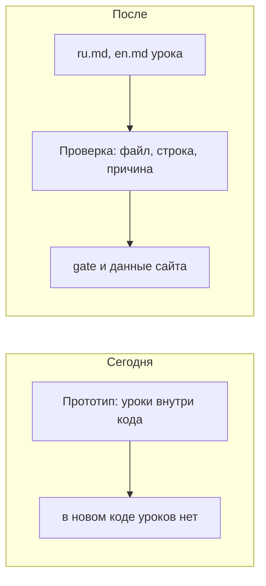

# Design: M1.1 — Формат урока в Markdown: файл урока и проверка

> Status: approved 2026-11-18 r2 · Revision: r2 · Date: 2026-11-18 · Author: Claude (craftspec design)
> Artifact: https://claude.ai/artifact/Pert7Z6UKR1yd73v9vQukp
> Approvers: anyone · Quorum: 1
> Involvement: light
> Rounds: none
> Bench: none
> Tokens: none
> Accepted below AA: none
> Human touches: 4 · As built: not yet
> Playbook: `<CraftSpec>/playbooks/design.md`. Section order is fixed; write "none" if empty.

**Changes since r1:** владелец ответил на D3 «Something else: меняем всё на Markdown, YAML
убираем вообще». Урок теперь пишется в Markdown, YAML в проекте нет; это заменяет решение K10
в части формата. Новый D3 — как разложить урок по файлам. Тексты могут использовать
Markdown (жирный, курсив, списки, код), см. E4. D1, D2 и D4 не изменились, ответы на них
сохраняются.

## 1. What changes for users

Урок — это обычный Markdown-файл в репозитории: заголовок, список участников схемы (атакующий,
сервер, база и так далее), зоны доверия, шаги с тремя уровнями объяснения. Его можно читать
прямо на GitHub и править как текст; YAML нигде нет. Если в файле ошибка, проверка называет
файл, строку и причину. На сайте пока ничего не меняется: это основа для сцены, плеера и
панели объяснения.

**How (for engineers):** `content/lessons/<id>/<язык>.md`, разбор `mdast-util-from-markdown`
при сборке, свой валидатор в `src/core/lesson` с ошибками «файл:строка», проверка в
`npm run gate`, урок B1 как первый настоящий файл.

## 2. What changes

Страница показывает пример файла урока B1 в Markdown (вкладка «Урок»: D1 — участники и зоны,
D2 — шаги с пометкой защиты, D3 — один файл на язык; D4 — три уровня у шага) и сообщения
проверки при ошибке.

## 3. Questions

### D1. Как автор урока расставляет участников на схеме?  ·  sketch: lesson · unchanged since r1

- **a. (Recommended)** Участники перечислены по порядку и встают в одну линию слева направо; зоны
  доверия задаются списком участников — так устроен прототип, который ты одобрил, и автору не
  нужны координаты.
- **b.** Клетки сетки: у участника столбец и ряд, рядов до двух.
- **c.** Свободные координаты.
- **Something else** — comment required.

### D2. Как в файле описан ход «с защитой»?  ·  sketch: lesson · unchanged since r1

- **a. (Recommended)** Один список шагов; у шага пометка «всегда», «только без защиты» или «только
  с защитой» — общие шаги пишутся один раз.
- **b.** Два полных списка шагов, как в прототипе.
- **Something else** — comment required.

### D3. Как урок разложен по файлам?  ·  sketch: lesson

- **a. (Recommended)** Один Markdown-файл на язык: `ru.md` — весь урок целиком, `en.md` — его
  перевод той же формы. Служебные строки (кто кому шлёт, вид сообщения, пометка защиты)
  одинаковы во всех языках, и проверка сверяет, что переводы им не противоречат.
  - Pros: автор читает и пишет урок одним файлом сверху вниз; на GitHub выглядит как статья
  - Cons: служебные строки повторяются в каждом языке; поменять схему — поправить все языки
- **b.** Схема урока отдельно (`lesson.md`), тексты по языкам отдельно (`ru.md` со ссылками на
  шаги по имени) — схема одна на все языки, но текст без схемы рядом читать трудно.
  - Pros: схема в одном месте; переводчик видит только текст
  - Cons: два файла на один урок; в файле текстов шаги без контекста
- **Something else** — comment required.

### D4. Обязательны ли все три уровня объяснения у каждого шага?  ·  sketch: lesson · unchanged since r1

- **a. (Recommended)** Да: «Просто», «По шагам» и «Глубже» заполнены у каждого шага.
- **b.** Обязательно только «Просто».
- **Something else** — comment required.

## 4. Engineering decisions

- **E1.** Формат — Markdown, YAML в проекте нет (решение владельца, заменяет K10 в части формата):
  `content/lessons/<id>/<язык>.md`. Ключи и имена — служебные слова в обратных кавычках
  (`` `server` ``, `` `attack` ``), они не переводятся; всё остальное — текст.
- **E2.** Разбор Markdown пакетом `mdast-util-from-markdown` (MIT, только при сборке и в тестах): он
  отдаёт строку и столбец каждого узла. Свой построчный разборщик проиграл: Markdown полон
  крайних случаев. `remark` целиком не нужен.
- **E3.** Свой валидатор в `src/core/lesson`: ошибки — данные `{file, line, column, path, code,
  message}`, без исключений, как в реестре команд (K13).
- **E4.** В тексте разрешён Markdown: абзацы, жирный, курсив, списки, код в строке и блоки кода;
  пометка `⟦…⟧` выделяет вредную часть внутри кода. Запрещены HTML, картинки и ссылки — ссылки
  только в разделе «Источники». Сайт показывает текст через свои компоненты, не вставляет HTML.
- **E5.** Враждебный файл (L0.2): больше 64 КБ, неизвестный раздел, неизвестное служебное слово,
  HTML внутри — ошибка с файлом и строкой.
- **E6.** Паспорт урока — служебные строки: `cwe`, `owasp`, `attack`, `cvss`, `cves`, `severity`; раздел
  «Источники» — список ссылок. Нужны калькулятору CVSS и сверке фактов (L5).
- **E7.** Правила содержания (S8, L4): у урока об атаке есть шаг «только с защитой» и раздел «Как
  защититься»; есть хотя бы один источник; все IP-адреса и домены — только учебные; у каждого
  шага в `ru.md` все три уровня; файл другого языка совпадает с `ru.md` по служебным строкам.
- **E8.** Ссылки в «Источниках» — только на домены из `content/sources.md` (OWASP, MITRE, NVD, RFC
  Editor, FIRST, CISA, W3C, WHATWG, MDN); список расширяется через pull request.
- **E9.** Виды сообщения `legit`, `attack`, `safe`; исход `stopped` — отдельная пометка шага.
- **E10.** В файле есть строка `` `format` 1 ``; раздел «Песочница» в первой версии запрещён (место
  под G2).
- **E11.** Проверка контента — тест в gate и команда `npm run content`; данные для сайта собирает
  плагин Vite, урок уходит отдельным файлом не больше 30 КБ.
- **E12.** Словарь в этот дизайн не входит (M2), но тоже будет Markdown.

## 5. How it is tested

**Summary:** уровень D (сценарий S8 и точные утверждения): урок B1 проходит, каждый испорченный
вариант падает с названным файлом, строкой и причиной.

| Check | Given / When / Then (or command) | Level |
|---|---|---|
| B1 проходит | Given `content/lessons/B1/ru.md`; When `npm run gate`; Then ошибок контента нет | D |
| S8: нет защиты | урок без шага «только с защитой» → gate красный, названы урок, раздел, строка | D |
| S8: адрес вне учебных | `8.8.8.8` или `google.com` в тексте → ошибка с файлом и строкой | D |
| S8: нет источников | пустой раздел «Источники» → ошибка | D |
| Нет уровня | шаг без «Глубже» → ошибка называет шаг | D |
| Перевод расходится | `en.md` с другим получателем в шаге → ошибка | D |
| Враждебный файл | HTML, картинка, ссылка в тексте шага, 1 МБ, `__proto__` как имя → ошибки-данные | D |
| Мутации | верификатор ломает правила — тесты краснеют | D |

## 6. Risks and rollback

**Summary:** главный риск — служебные строки в Markdown окажутся хрупкими для авторов; откат —
revert, сайт формат ещё не использует.

| Risk | Mitigation |
|---|---|
| Автор ломает служебную строку и не понимает ошибку | сообщение называет строку и показывает правильный вид; образец урока в руководстве автора (M4.1) |
| Формат придётся менять после 36 уроков | строка `format`; второй урок другого вида (I1) в этом же дизайне как проверка |
| Ложные срабатывания правила учебных адресов | проверяется на текстах трёх уроков прототипа |

- **Rollback:** revert коммитов.
- **Needs a human (AGENTS.md L3):** none. Новые зависимости `mdast-util-from-markdown` и её
  пакеты — под MIT, в списке L1; рабочий проверяет лицензии всех и останавливается, если найдёт
  чужую.

## 7. Files

**Summary:** новая папка `content/` с двумя уроками и новый модуль `src/core/lesson`.

Migrations, new dependencies and new services: `mdast-util-from-markdown` (MIT, devDependency) и
её пакеты. Миграций и сервисов нет.

| Path (or directory) | Change | Module owner |
|---|---|---|
| `content/lessons/B1/ru.md`, `content/lessons/I1/ru.md` | new | контент |
| `content/sources.md` | new | контент |
| `src/core/lesson/` (типы, валидатор, тесты, README) | new | core |
| `scripts/` (чтение контента, плагин Vite, тест контента) | new | scripts |
| `scripts/structure-check.mjs` | edit: ссылки разрешены только в «Источниках» | scripts |
| `package.json`, `package-lock.json`, `vite.config.ts` | edit | корень |
| `plan/architecture.md`, `plan/execution-plan.md` | edit: YAML → Markdown | план |

## 8. Tasks

**Summary:** 3 задачи, ≈7 агент-часов; M1.1a первой, затем M1.1b и M1.1c параллельно.

| Id | Task | Acceptance | Oracle | Est | Deps | Module | Parallel |
|---|---|---|---|---|---|---|---|
| M1.1a | Формат и валидатор на уроке B1 | `B1/ru.md` проходит; испорченные варианты из S8 дают ошибку с файлом, строкой и причиной; gate включает проверку контента | D S8 | 3 h | M0.1 | `src/core/lesson`, `content/` | — |
| M1.1b | Данные урока для сайта | сборка кладёт каталог и урок отдельным файлом не больше 30 КБ; тест читает B1 из собранных данных; текст урока — дерево узлов, не HTML | D | 2 h | M1.1a | `scripts/`, `vite.config.ts` | A |
| M1.1c | Второй урок как проверка формата: I1 «Фишинг» | I1 из прототипа записан в том же формате без изменения формата, или изменения перечислены и согласованы ревизией дизайна | D | 2 h | M1.1a | `content/` | A |

## 9. Answers

Each revision's page carries the sha256 of this file as committed for it:
r1 `a1ef725aae655a52bd0acf3f372d5710b3d08d74e6ab2538b36d4c9ce5538f30`, r2 `1a0a99f69726f6f5008ec194d7ee43567f652311922b49ba3b3a0e4c392a61cd`.

| Rev | D | Who | Choice | Also | Answer | Comment | At |
|---|---|---|---|---|---|---|---|
| r1 | D1 | owner | a | | yes | | 2026-11-17 21:16 |
| r1 | D2 | owner | a | | yes | | 2026-11-17 21:16 |
| r1 | D3 | owner | other | | no | «давай да меняем все на md формат, убираем yaml вообще» | 2026-11-17 21:17 |
| r1 | D4 | owner | a | | yes | | 2026-11-17 21:17 |
| r2 | D1, D2, D4 | owner | a (carried from r1) | | yes | | 2026-11-17 |
| r2 | D3 | owner | a | | yes | | 2026-11-18 15:29 |
