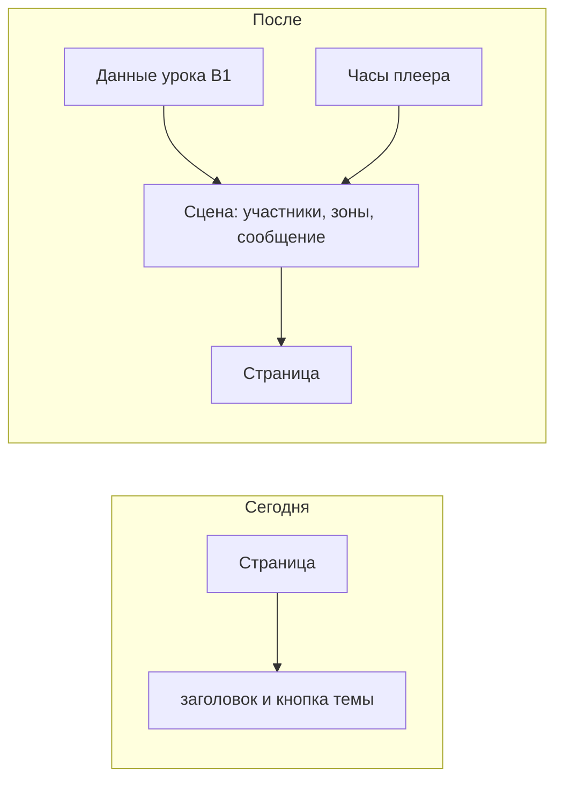

# Design: M1.2 — Сцена: участники, зоны доверия, иконки, движение сообщения

> Status: awaiting-approval · Revision: r1 · Date: 2026-11-18 · Author: Claude (craftspec design)
> Artifact: https://claude.ai/artifact/2TTAMfjL1v9Y3CLMrKXc7Q
> Approvers: anyone · Quorum: 1
> Involvement: light
> Rounds: none
> Bench: none
> Tokens: none
> Accepted below AA: none
> Human touches: 1 · As built: not yet
> Playbook: `<CraftSpec>/playbooks/design.md`. Section order is fixed; write "none" if empty.

## 1. What changes for users

На странице появляется схема урока «SQL-инъекция»: участники в ряд в стиле ризографии, пунктирные
рамки зон доверия и сообщение-плашка, которое едет от одного участника к другому. Выглядит как
в прототипе, который ты одобрил, но собрано в настоящем коде и работает на телефоне без
прокрутки вбок. Кнопок плеера, объяснения и таблицы шагов ещё нет: шаг переключается только
из тестов, это следующие задачи.

**How (for engineers):** компонент `src/scene` рисует SVG из данных урока и времени часов
плеера (K17), раскладка — чистая функция в ядре, цвета и шрифты только из токенов, анимаций
CSS нет.

## 2. What changes

Sketch: «Сегодня» — страница с заголовком и кнопкой темы. «После», три вкладки: «Без защиты»
(D1 — иконки участников, D3 — сообщение в пути), «С защитой» (D3 — остановленное сообщение),
«Телефон и тёмная тема» (D2 — сцена в тёмной теме, D4 — узкий экран).

## 3. Questions

### D1. Откуда берутся иконки участников?  ·  sketch: attack

- **a. (Recommended)** Те же восемь иконок-ризографий, что в прототипе: вырезаем их из трёх
  одобренных листов как есть — вид уже утверждён (K5), новых трат нет.
  - Pros: ровно тот вид, который ты выбрал; бесплатно; готово сразу
  - Cons: это картинки, а не чертёж: при сильном увеличении мылятся и не перекрашиваются; условия
    Magnific на публикацию ещё не проверены (G10)
- **b.** Перерисовать иконки вручную в SVG в том же стиле — чёткие в любом размере и меняют цвет
  по теме, но это уже другие картинки, каждую придётся принимать заново.
  - Pros: чёткость, малый вес, тёмная тема, нет вопроса о лицензии Magnific
  - Cons: вид изменится; восемь иконок сейчас и десятки потом — заметная ручная работа
- **Something else** — comment required.

### D2. Как сцена выглядит в тёмной теме?  ·  sketch: phone

- **a. (Recommended)** Сцена остаётся светлым «листом бумаги» в обеих темах, темнеет всё вокруг
  неё — ризография печатается на бумаге, и иконки не приходится переделывать.
  - Pros: иконки и краски выглядят одинаково всегда; дёшево
  - Cons: в тёмной теме на экране остаётся светлый прямоугольник
- **b.** Сцена тоже темнеет — цельнее выглядит ночью, но для каждой иконки нужен вариант с
  прозрачным фоном и проверка на тёмном.
  - Pros: цельная тёмная тема
  - Cons: обработка иконок стоит кредитов Magnific или ручной работы; часть красок на тёмном
    теряется
- **Something else** — comment required.

### D3. Как показать, что защита остановила сообщение?  ·  sketch: defence

- **a. (Recommended)** Вредная плашка доезжает до защитника, останавливается у него со знаком
  щита и словом «остановлено», дальше по линии не идёт — видно, где именно атака упёрлась.
  - Pros: исход понятен без чтения текста; совпадает со сценарием «защита меняет исход»
  - Cons: новое по сравнению с прототипом, там остановки на схеме не было
- **b.** Как в прототипе: отдельного показа остановки нет, в режиме защиты просто идут зелёные
  сообщения, а про остановку написано в таблице шагов.
  - Pros: ничего нового делать не надо
  - Cons: на самой схеме не видно, что атаку остановили
- **Something else** — comment required.

### D4. Как схема помещается на телефоне?  ·  sketch: phone

- **a. (Recommended)** Схема целиком по ширине экрана: иконки меньше, подписи остаются читаемого
  размера, длинные подписи переносятся; прокрутки вбок нет.
  - Pros: всё видно сразу; выполняет сценарий «Телефон»
  - Cons: при шести участниках иконки на телефоне мелкие (около 50 px)
- **b.** Как в прототипе: схема шире экрана и прокручивается вбок — иконки крупные, но часть
  участников не видна, и сообщение уезжает за край.
  - Pros: крупно
  - Cons: нарушает сценарий «Телефон»; движение сообщения видно не целиком
- **Something else** — comment required.

## 4. Engineering decisions

- **E1.** Сцена — один компонент Svelte в `src/scene`, рисует SVG; раскладка (где стоит участник,
  зона, сообщение при доле пути 0…1) — чистая функция `src/core/scene-layout`, её проверяют
  модульные тесты без браузера. Canvas проиграл: нет доступности и стабильных `data-testid`.
- **E2.** Положение сообщения считается из времени часов плеера (K17), не из CSS и не из
  `requestAnimationFrame` в компоненте: один и тот же момент времени даёт один и тот же кадр.
  При `prefers-reduced-motion` сообщение сразу у цели (S11).
- **E3.** Цвета, шрифты, радиусы — токены в `src/ui/tokens.css` из палитры стиль-гайда (светлая и
  тёмная), сцена получает свои токены бумаги и красок. Буквальные цвета в `src/` запрещает gate.
- **E4.** Запрет CSS-анимаций и переходов в `src/` проверяет gate (закрывает G14): иначе время
  уходит мимо часов плеера.
- **E5.** Иконки: восемь вырезок из `prototype/assets/sheet-*.jpg` в `content/icons/<имя>.jpg`,
  сделанные один раз локальной командой; мягкие края как в прототипе. Библиотека обработки
  картинок в проект не добавляется. Каждая иконка записывается в `ATTRIBUTION.md` (L1).
- **E6.** Шрифты Onest и JetBrains Mono (оба SIL OFL) лежат в `public/fonts` и раздаются с сайта
  (L6); без своих шрифтов снимки экрана различались бы между машинами.
- **E7.** Зоны доверия — пунктирные рамки с подписью в углу; опасная зона (подделка) красная.
  Красный — только у атакующего, его сообщений и опасной зоны.
- **E8.** Текущий шаг: рамка вокруг участника-получателя и след за сообщением; у сообщения цвет
  всегда продублирован знаком («!», «✓», щит) и словом.
- **E9.** Доступность: у сцены текстовое описание текущего шага («Шаг 3: сервер → база, вредный
  запрос»), у участников и зон стабильные `data-testid`. Нажатия на участников и зоны (словарь)
  — в M2.
- **E10.** Шаг и режим защиты сцена получает через состояние приложения и временные команды
  `scene.step` и `scene.defence`; настоящий плеер (M1.3) заменит их своими.
- **E11.** Снимок сцены B1 на шаге 3 снимается дважды и сравнивается побайтно (как в M0.4);
  внешний вид оценивает верификатор по рубрике R-UI. Эталонную картинку в репозиторий не кладём,
  пока вид не утверждён «как построено».

## 5. How it is tested

**Summary:** уровень C для вида (рубрика R-UI по снимку, стиль-гайд R9) и D для поведения:
раскладка и движение проверяются точными утверждениями, снимок — повторяемостью.

| Check | Given / When / Then (or command) | Level |
|---|---|---|
| Раскладка | Given сцена B1 и ширина 760 и 390; Then участники, зоны и подписи не выходят за границы и не накладываются | D |
| Движение по часам | Given шаг 3, `clock.set`; When время на середине шага; Then сообщение на середине пути; два прогона дают равные снимки | A |
| Остановка | Given режим защиты, шаг с вредным запросом; Then сообщение стоит у защитника со словом «остановлено», получатель его не получает | D S2 |
| Без движения | Given `prefers-reduced-motion`; When шаг; Then сообщение сразу у цели | D S11 |
| Телефон | Given 390 px; Then нет прокрутки вбок, подписи не меньше 11 px | D S10 |
| Токены | в `src/` нет буквальных цветов; контраст текста токенов не ниже 4.5:1 в обеих темах | B R9 |
| Вид | снимок B1, шаг 3 → рубрика R-UI, не меньше 8 из 10 | C R9 |

## 6. Risks and rollback

**Summary:** главный риск — вырезанные из JPEG иконки выглядят хуже, чем в прототипе, на плотных
экранах; откат — revert, страница вернётся к заголовку с кнопкой.

| Risk | Mitigation |
|---|---|
| Иконки мылятся на экранах высокой плотности (вырезка около 310×275 px) | показать «как построено» на телефоне и ноутбуке; если плохо — ревизия с вариантом D1 b |
| Условия Magnific не разрешают публикацию иконок (G10) | репозиторий закрыт до M4.4, где условия проверяются; вариант D1 b снимает вопрос |
| Шрифты добавляют вес первой загрузке | только нужные начертания, подмножества кириллицы и латиницы; бюджет 150 КБ JS не затрагивается, вес шрифтов измеряется и записывается |
| Строгая политика содержимого сайта запрещает встроенные стили | сцена задаёт положение атрибутами SVG, а не `style=`; e2e идёт под теми же заголовками |

- **Rollback:** revert коммитов.
- **Needs a human (AGENTS.md L3):** none при D1 a и D2 a. Вариант D2 b означает траты на обработку
  иконок — их придётся согласовать отдельно.

## 7. Files

**Summary:** новые модули сцены и токенов, иконки и шрифты как файлы; реестр команд и канал
управления не меняются.

Migrations, new dependencies and new services: зависимостей нет. Новые ассеты: 8 иконок
(`content/icons/*.jpg`, из своих листов), шрифты Onest и JetBrains Mono (SIL OFL).

| Path (or directory) | Change | Module owner |
|---|---|---|
| `src/core/scene-layout/` | new | core |
| `src/scene/` | new | scene |
| `src/ui/tokens.css`, `src/ui/App.svelte` | new / edit | ui |
| `src/commands/scene.ts`, `src/core/state.ts` | new / edit | commands, core |
| `content/icons/`, `public/fonts/`, `ATTRIBUTION.md` | new | контент |
| `scripts/structure-check.mjs` (+ тесты) | edit: буквальные цвета и CSS-анимации | scripts |
| `e2e/scene.spec.ts` | new | e2e |
| `src/ui/ClockReadout.svelte` | delete (K17: убрать, когда появится сцена) | ui |

## 8. Tasks

**Summary:** 3 задачи, ≈9 агент-часов, по очереди; первая показывает неподвижную сцену B1 на
странице.

| Id | Task | Acceptance | Oracle | Est | Deps | Module | Parallel |
|---|---|---|---|---|---|---|---|
| M1.2a | Неподвижная сцена B1: токены, шрифты, иконки, участники и зоны | на черновом адресе видна сцена B1 в обеих темах; раскладка проходит тесты на 760 и 390 px; в `src/` нет буквальных цветов | C R9 · D | 4 h | M1.1a, M0.4 | `src/scene`, `src/core/scene-layout`, `src/ui` | — |
| M1.2b | Движение сообщения по часам плеера, виды сообщения, остановка защитой | шаг 3 B1: сообщение на середине пути в середине шага; в режиме защиты остановлено у защитника; два прогона дают равные снимки; S11 | A · D S2 S11 | 3 h | M1.2a | `src/scene`, `src/commands` | — |
| M1.2c | Телефон и проверки стиля | S10 на 390 px; gate запрещает CSS-анимации в `src/` (G14); снимок шага 3 проходит R-UI у верификатора | C R9 · D S10 | 2 h | M1.2b | `src/scene`, `scripts/` | — |

## 9. Answers

Each revision's page carries the sha256 of this file as committed for it:
r1 `SHA_R1`.

| Rev | D | Who | Choice | Also | Answer | Comment | At |
|---|---|---|---|---|---|---|---|
| | | | | | | | |
