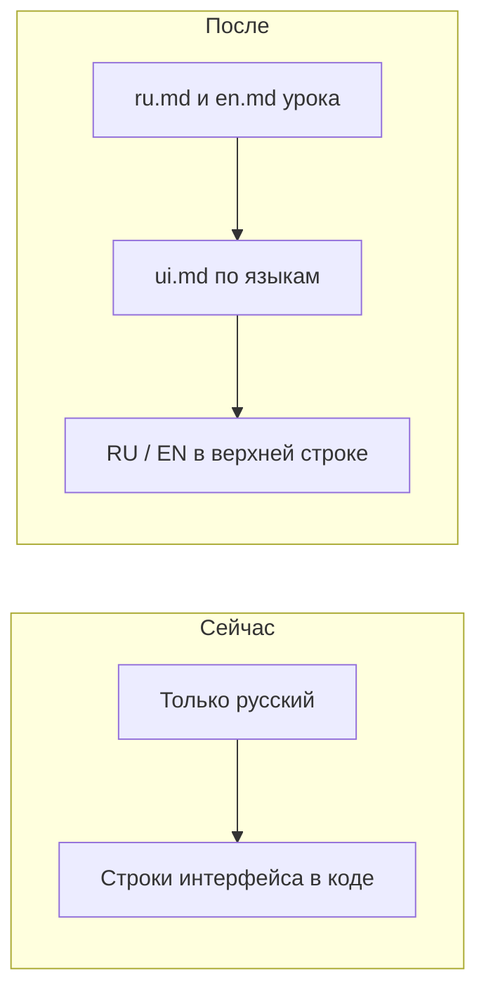

# Design: M2.3 — Языки: русский и английский, правило неполного перевода

> Status: approved 2026-11-19 r2 · Revision: r2 · Date: 2026-11-19 · Author: Claude (craftspec design)
> Artifact: https://claude.ai/artifact/47Hamqgnwd7Wfwi2WMowd4
> Approvers: anyone · Quorum: 1
> Involvement: light
> Rounds: none
> Bench: none
> Tokens: none
> Accepted below AA: none
> Human touches: 1 · As built: not yet
> Playbook: `<CraftSpec>/playbooks/design.md`. Section order is fixed; write "none" if empty.

**Changes since r1:** владелец ответил на D1 «Something else»: «в CI надо проверять что все уроки есть на всех языках, если добавляется язык - все уроки переводятся на него, если добавляется урок, делается сразу на всех языках». D1 переписан его словами и утверждён ими же; сценарий S9 меняется: недостающий перевод валит gate. D2 и D3 — вариант «a», без изменений.

## 1. What changes for users

Сайт работает на русском и английском: переключатель «RU / EN» в верхней строке, адрес
начинается с `/ru/` или `/en/`, при смене языка остаётся тот же урок, шаг и режим. Новый язык
добавляется папкой файлов через pull request; язык появляется в меню, только когда переведён
весь выпуск. Уроки «SQL-инъекция» и «Фишинг» получают английскую версию.

**How (for engineers):** `content/lessons/<id>/en.md` (формат уже готов, K21, K24), тексты
интерфейса в `content/locales/<lang>/ui.md`, сервис `src/services/i18n`, команда `locale.set`,
адрес из M2.2, проверка полноты в gate печатает недостающее и не падает (S9).

## 2. What changes

## 3. Questions

### D1. Когда язык появляется в меню?  ·  r2: решение владельца

- **a. (Recommended, owner)** Каждый урок есть на каждом языке сайта, и gate это проверяет: недостающий перевод — ошибка. Добавляешь язык — переводишь все уроки и интерфейс; добавляешь урок — сразу на всех языках. Неполного языка на сайте не бывает.
- **b.** (r1) Язык в меню, когда переведён весь выпуск; до этого gate только печатает недостающее.
- **Something else** — comment required.

### D2. Кто пишет английский для первого выпуска?

- **a. (Recommended)** Агент переводит, проверяющий сверяет факты как для русского; носитель
  языка вычитает позже — это записывается в открытые вопросы.
  - Pros: английский готов вместе с уроками
  - Cons: текст без вычитки носителем
- **b.** Ждём переводчика-человека; до него английского нет.
  - Pros: язык выше качеством
  - Cons: выпуск только на русском
- **Something else** — comment required.

### D3. Какой язык видит новый посетитель?

- **a. (Recommended)** По языку браузера: русский для тех, у кого он русский (или украинский,
  белорусский, казахский), остальным английский; выбор запоминается в браузере.
  - Pros: иностранец сразу понимает сайт
  - Cons: часть русскоязычных с английским браузером увидит английский
- **b.** Всегда русский, английский — по кнопке.
  - Pros: просто и предсказуемо
  - Cons: иностранец может уйти, не поняв, что есть английский
- **Something else** — comment required.

## 4. Engineering decisions

- **E1.** Адрес `/<lang>/lesson/<id>#…` (M2.2); смена языка через команду `locale.set` сохраняет
  урок, шаг, режим и глубину (S5).
- **E2.** Тексты интерфейса — `content/locales/<lang>/ui.md`: служебное слово ключа и текст, в
  Markdown, как уроки (K18); ключи сверяются с русским файлом.
- **E3.** Проверка полноты в gate (D1 r2): каждый урок и каждый ключ интерфейса есть на каждом языке из списка языков сайта; иначе gate падает и печатает недостающее. S9 переписан.
- **E4.** Заголовки разделов урока на английском уже есть в таблице языков (K24).
- **E5.** Названия разделов каталога и словарь (M2.4) — тоже по языкам.
- **E6.** Язык в `localStorage` (архитектура §5), адрес важнее сохранённого.

## 5. How it is tested

**Summary:** уровень D: сценарии S5 и S9.

| Check | Given / When / Then (or command) | Level |
|---|---|---|
| S5 | B1, шаг 3, ru → `locale.set en` → тот же шаг и режим, все видимые строки на английском, адрес `/en/` | D |
| S9 | язык, где не хватает урока или ключа → gate красный и печатает, чего не хватает | D |
| Перевод | `en.md` B1 и I1 проходят проверку и сверку служебных строк с `ru.md` | D |
| Факты | верификатор сверяет английский текст по R-FACT | C |

## 6. Risks and rollback

**Summary:** главный риск — английский текст без вычитки носителем; откат — revert.

| Risk | Mitigation |
|---|---|
| Неуклюжий английский | открытый вопрос «вычитка носителем» до открытого выпуска |
| Строки интерфейса забыты в коде | проверка: в `src/ui` нет русских букв вне тестов |

- **Rollback:** revert.
- **Needs a human (AGENTS.md L3):** none.

## 7. Files

**Summary:** новый сервис языков и файлы переводов.

Migrations, new dependencies and new services: none.

| Path (or directory) | Change | Module owner |
|---|---|---|
| `src/services/i18n/`, `src/commands/locale.ts` | new | services, commands |
| `content/locales/ru/ui.md`, `content/locales/en/ui.md` | new | content |
| `content/lessons/B1/en.md`, `content/lessons/I1/en.md` | new | content |
| `src/ui/*` | edit: строки из ui.md | ui |
| `scripts/lesson-data.ts`, `scenarios/lesson-player.md` (S9) | edit: полнота в gate | scripts, plan |

## 8. Tasks

**Summary:** 2 задачи, ≈7 агент-часов; вторая параллельно с другими задачами M2.

| Id | Task | Acceptance | Oracle | Est | Deps | Module | Parallel |
|---|---|---|---|---|---|---|---|
| M2.3a | Языки в коде: `ui.md`, сервис, `locale.set`, адрес, правило полноты | S5 и S9 зелёные на русском и английском интерфейсе | D S5 S9 | 4 h | M2.2 | services, ui, scripts | — |
| M2.3b | Английские версии уроков B1 и I1 | `en.md` проходят проверку; верификатор сверил факты по R-FACT | C R4 R7 | 3 h | M2.3a | content | A |

## 9. Answers

r1 `SHA_R1`.

| Rev | D | Who | Choice | Also | Answer | Comment | At |
|---|---|---|---|---|---|---|---|
| | | | | | | | |
| r1 | D1 | owner | other | | no | «в CI надо проверять что все уроки есть на всех языках, если добавляется язык - все уроки переводятся на него, если добавляется урок, делается сразу на всех языках» | 2026-11-19 04:46 |
| r1 | D2 | owner | a | | yes | | 2026-11-19 04:46 |
| r1 | D3 | owner | a | | yes | | 2026-11-19 04:46 |
| r2 | D1 | owner (своими словами в r1) | a | | yes | | 2026-11-19 |
